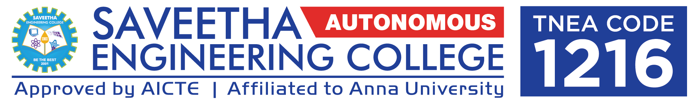
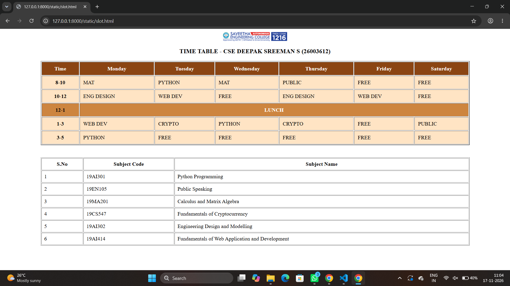

# Ex04 Time Table
## Date: 17-11-2026

## AIM
To write a html webpage page to display your slot timetable.

## ALGORITHM
### STEP 1
Create a Django-admin Interface.

### STEP 2
Create an App inside the Django project.

### STEP 2
Create a static folder uder the created App and insert HTML code.

### STEP 3
Create a simple table using ```<table>``` tag in html with the relevant attributes.

### STEP 4
Add rows using ```<tr>``` tag.

### STEP 5
Add your course schedule using ```<td>``` tag.

### STEP 6
Execute the program using runserver command.

## PROGRAM
```
<html>
<body>

<center>



<h3>TIME TABLE - CSE DEEPAK SREEMAN S (26003612)</h3>

<table border="2" cellpadding="10" cellspacing="2" width="85%">

<tr bgcolor="saddlebrown">
<th><font color="white">Time</font></th>
<th><font color="white">Monday</font></th>
<th><font color="white">Tuesday</font></th>
<th><font color="white">Wednesday</font></th>
<th><font color="white">Thursday</font></th>
<th><font color="white">Friday</font></th>
<th><font color="white">Saturday</font></th>
</tr>

<tr bgcolor="bisque">
<th>8-10</th>
<td>MAT</td>
<td>PYTHON</td>
<td>MAT</td>
<td>PUBLIC</td>
<td>FREE</td>
<td>FREE</td>
</tr>

<tr bgcolor="bisque">
<th>10-12</th>
<td>ENG DESIGN</td>
<td>WEB DEV</td>
<td>FREE</td>
<td>ENG DESIGN</td>
<td>WEB DEV</td>
<td>FREE</td>
</tr>

<tr bgcolor="peru">
<th>12-1</th>
<th colspan="6"><font color="white">LUNCH</font></th>
</tr>

<tr bgcolor="bisque">
<th>1-3</th>
<td>WEB DEV</td>
<td>CRYPTO</td>
<td>PYTHON</td>
<td>CRYPTO</td>
<td>FREE</td>
<td>PUBLIC</td>
</tr>

<tr bgcolor="bisque">
<th>3-5</th>
<td>PYTHON</td>
<td>FREE</td>
<td>FREE</td>
<td>FREE</td>
<td>FREE</td>
<td>FREE</td>
</tr>

</table>

<br><br>

<table border="1" cellpadding="8" cellspacing="2" width="85%">

<tr>
<th>S.No</th>
<th>Subject Code</th>
<th>Subject Name</th>
</tr>

<tr>
<td>1</td>
<td>19AI301</td>
<td>Python Programming</td>
</tr>

<tr>
<td>2</td>
<td>19EN105</td>
<td>Public Speaking</td>
</tr>

<tr>
<td>3</td>
<td>19MA201</td>
<td>Calculus and Matrix Algebra</td>
</tr>

<tr>
<td>4</td>
<td>19CS547</td>
<td>Fundamentals of Cryptocurrency</td>
</tr>

<tr>
<td>5</td>
<td>19AI302</td>
<td>Engineering Design and Modelling</td>
</tr>

<tr>
<td>6</td>
<td>19AI414</td>
<td>Fundamentals of Web Application and Development</td>
</tr>

</table>

</center>
</body>
</html>
```

## OUTPUT


## RESULT
The program for creating slot timetable using basic HTML tags is executed successfully.
